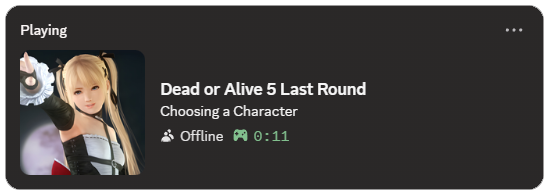
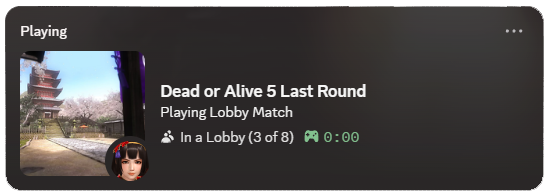

<div align="center">
  
  # DOA5LR Rich Presence for Discord

  Unofficial Discord Rich Presence for the STEAM release of <a href="https://store.steampowered.com/app/311730/DEAD_OR_ALIVE_5_Last_Round_Core_Fighters/">DEAD OR ALIVE 5 Last Round</a>.

  [](https://github.com/koenjicode/DOA5LR-Discord/releases/latest)
  [](https://github.com/koenjicode/DOA5LR-Discord/commits/main)
  [](https://github.com/koenjicode/DOA5LR-Discord/releases/latest)
  [](https://github.com/koenjicode/DOA5LR-Discord/blob/main/LICENSE)

</div>

> [!WARNING]
> This is an ASI plugin that reads static addresses in the game's memory and displays them on Discord.
> Releases of DOA5LR-Discord will include the ASI loader, but you may already have it if you've installed DOARevolution.
> Your antivirus may flag the required .dll as a virus. If this occurs, add the .dll to your exclusions.

## Preview

<div align="center">
  
  
</div>

## Features
- Detailed Rich Presence state breakdown that updates live in matches.
- Unique Small and Large icons for all 36 characters.
- 5 selectable fallback images: Default, Default JP, Ultimate, Ultimate JP & Vanilla.
- Ability to join lobbies directly through Discord.
- Configurable .ini to adjust presentation.

## Install

1. Download the latest release in the releases section.
2. Start Discord, then the game.

If Discord isn't running, the plugin waits and retries every 10 seconds. The game isn't affected.

## Build

You need Visual Studio 2022 with the *Desktop development with C++* workload, and CMake 3.20 or newer.

This project uses v3.2.1 of the now-legacy Discord Game SDK, which isn't included in this repository. You can download the library [here](https://github.com/ZackeryRSmith/discord-game-sdk).

Once downloaded, extract it into `third_party/discord_game_sdk`, so that `third_party/discord_game_sdk/c/discord_game_sdk.h` and `third_party/discord_game_sdk/lib/x86/discord_game_sdk.dll` exist. CMake stops with a message if it's missing.

```bash
cmake --preset win32
```

```bash
cmake --build --preset release
```

The output in `build/Release/` is `DOA5Discord.asi` and `discord_game_sdk.dll`.
The plugin links the CRT statically and loads the Discord SDK at runtime, so it has no other dependencies.

## Credits

DEAD OR ALIVE 5 Last Round and its characters and stages belong to KOEI TECMO GAMES.
