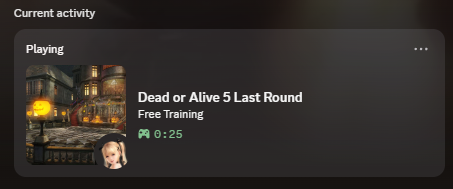

# DOA5LR-Discord

Discord Rich Presence for **DEAD OR ALIVE 5 Last Round**.
This is an ASI plugin that reads static addresses in the game's memory and displays them on Discord.



## Install

1. Download the latest release in the releases section.
2. Start Discord, then the game.

If Discord isn't running, the plugin waits and retries every 10 seconds. The game isn't affected.

## Build

You need Visual Studio 2022 with the *Desktop development with C++* workload, and CMake 3.20 or newer.

This project uses v3.2.1 of the now-legacy Discord Game SDK, which isn't included in this repository. You can download the library [here](https://github.com/ZackeryRSmith/discord-game-sdk).

Once downloaded, extract it into `third_party/discord_game_sdk`, so that `third_party/discord_game_sdk/c/discord_game_sdk.h` and `third_party/discord_game_sdk/lib/x86/discord_game_sdk.dll` exist. CMake stops with a message if it's missing.

```bash
cmake --preset win32
```

```bash
cmake --build --preset release
```

The output in `build/Release/` is `DOA5Discord.asi` and `discord_game_sdk.dll`.
The plugin links the CRT statically and loads the Discord SDK at runtime, so it has no other dependencies.

## Credits

DEAD OR ALIVE 5 Last Round and its characters and stages belong to KOEI TECMO GAMES.
